# 3D 交互模型库

一排可以直接在浏览器里打开、能转、能拆、能看内部结构的三维剖面模型：人体器官、机械装置、
日常物件。**11 个页面，每个都是一个独立的 HTML 文件**，没有构建步骤、不引用任何图片素材，
所有几何、贴图、环境与声音都由代码现场生成。

<table>
  <tr>
    <td align="center" width="33%">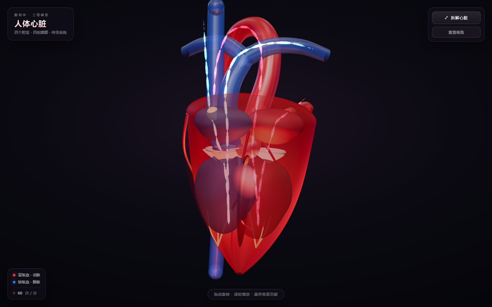<br><b>人体心脏</b><br><sub>四个腔室 · 四组瓣膜 · 传导系统</sub></td>
    <td align="center" width="33%">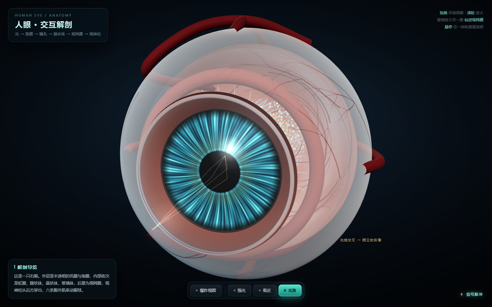<br><b>人眼</b><br><sub>角膜 · 虹膜 · 晶状体 · 视网膜</sub></td>
    <td align="center" width="33%">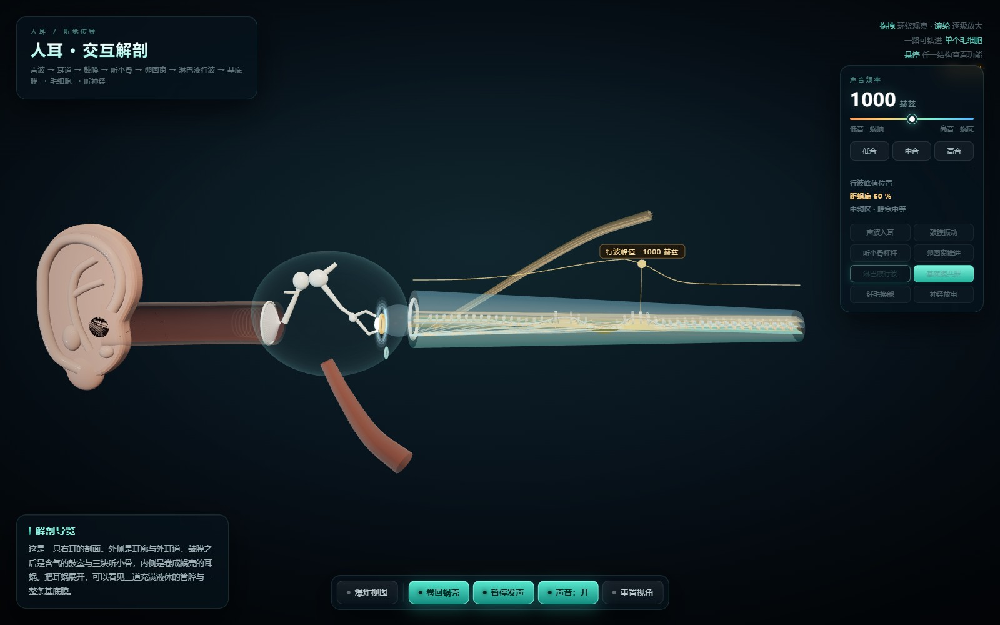<br><b>人耳</b><br><sub>声波 · 听小骨 · 耳蜗 · 听神经</sub></td>
  </tr>
  <tr>
    <td align="center">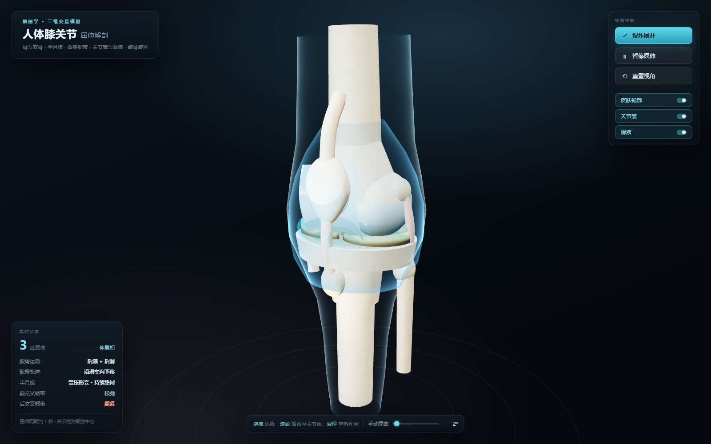<br><b>膝关节</b><br><sub>骨与软骨 · 半月板 · 韧带</sub></td>
    <td align="center">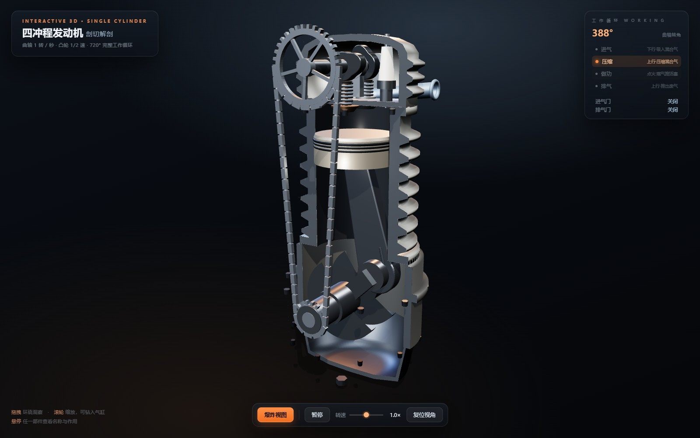<br><b>四冲程发动机</b><br><sub>吸气 · 压缩 · 做功 · 排气</sub></td>
    <td align="center">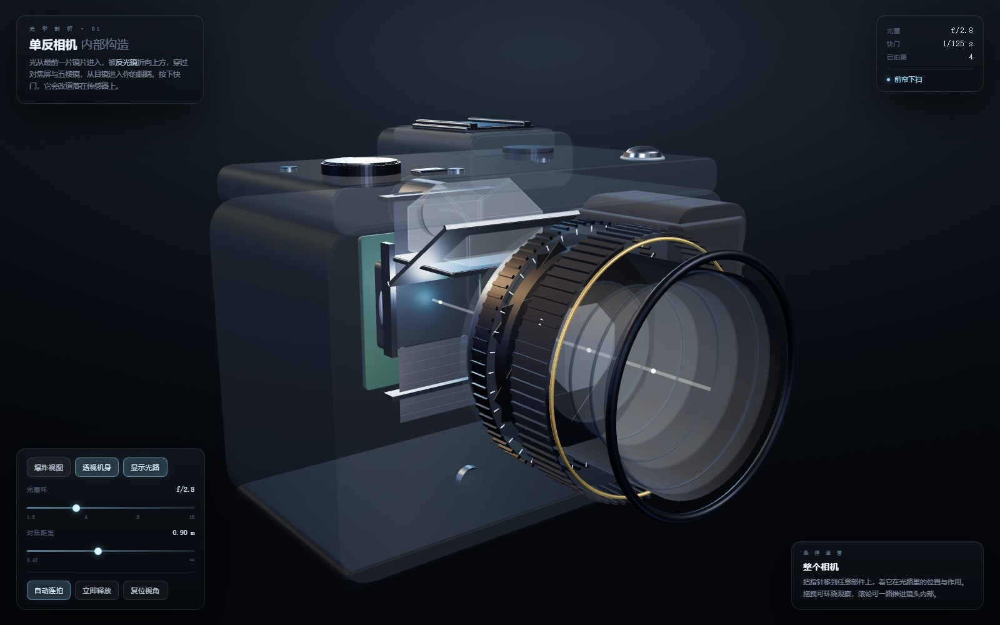<br><b>单反相机</b><br><sub>光路 · 光圈 · 快门 · 传感器</sub></td>
  </tr>
  <tr>
    <td align="center">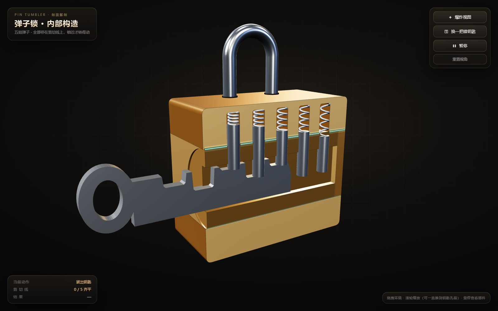<br><b>弹子锁</b><br><sub>五颗弹子 · 剪切线 · 错钥匙</sub></td>
    <td align="center">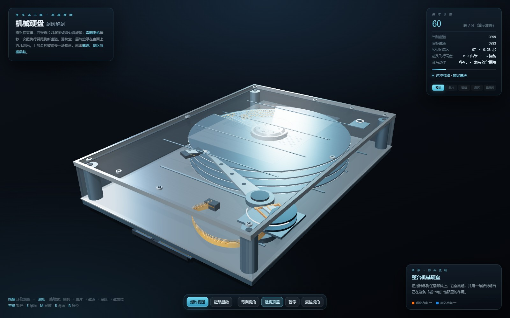<br><b>机械硬盘</b><br><sub>盘片 · 磁头 · 音圈电机</sub></td>
    <td align="center">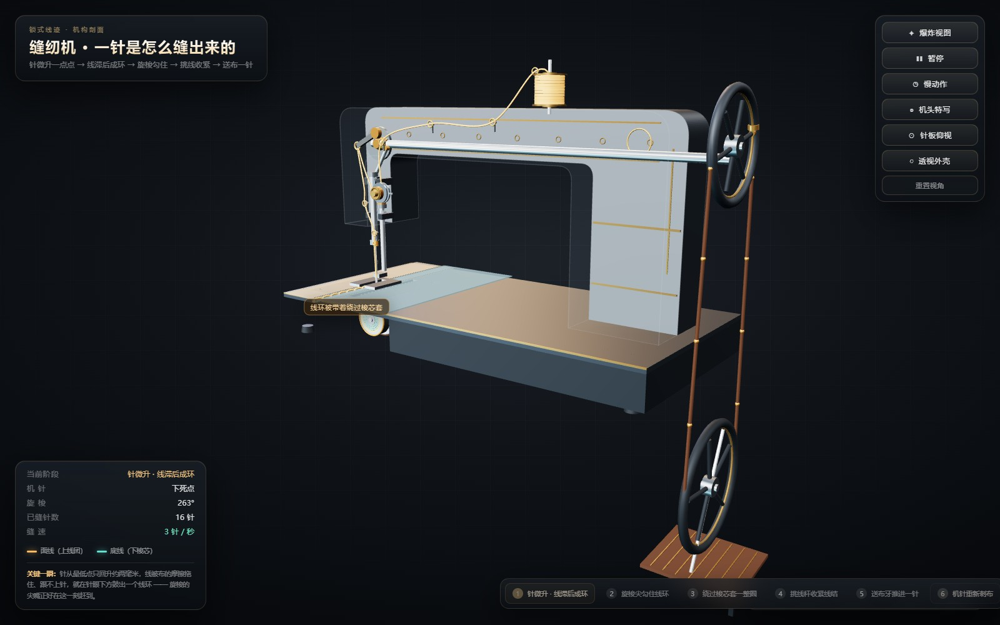<br><b>锁式线迹缝纫机</b><br><sub>机针 · 旋梭 · 送布</sub></td>
  </tr>
  <tr>
    <td align="center">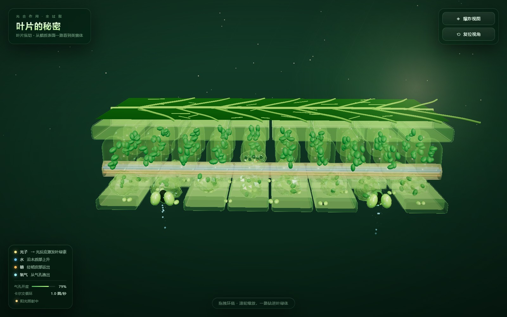<br><b>叶片光合作用</b><br><sub>栅栏组织 · 叶绿体 · 气孔</sub></td>
    <td align="center">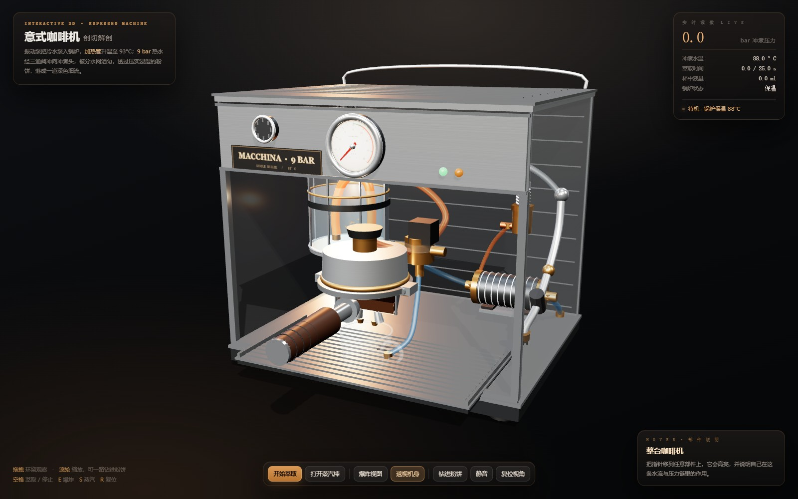<br><b>意式咖啡机</b><br><sub>泵 · 锅炉 · 冲煮头 · 粉饼</sub></td>
    <td align="center"><sub>截图由 <code>node tools/screenshots.mjs</code> 生成</sub></td>
  </tr>
</table>

## 快速开始

直接用浏览器打开 `pages/` 下的任意一个 `.html` 文件即可（双击就行）。页面通过 importmap 从
[unpkg](https://unpkg.com) 加载固定版本的 Three.js，**首次打开需要联网**；其余资源全部在页面内生成。

如果浏览器对本地模块有限制，或者想一次浏览全部页面，起一个静态服务器：

```bash
npx serve .          # 或：python -m http.server 8000
```

然后访问 `http://localhost:3000/pages/`（`npx serve` 默认 3000 端口，`http.server` 默认 8000）。

## 页面一览

| 分类 | 页面 | 文件 | 看什么 |
| --- | --- | --- | --- |
| 人体解剖 | 人体心脏 | `pages/心脏3D解剖.html` | 四腔、瓣膜开合、心动周期与传导系统 |
| 人体解剖 | 人眼 | `pages/人眼3D解剖.html` | 光线穿过角膜、瞳孔、晶状体落到视网膜 |
| 人体解剖 | 人耳 | `pages/人耳3D解剖.html` | 声波→鼓膜→听小骨→耳蜗行波→听神经 |
| 人体解剖 | 膝关节 | `pages/膝关节3D解剖.html` | 骨与软骨、半月板、韧带，屈伸全过程 |
| 机械与工程 | 弹子锁 | `pages/弹子锁3D解剖.html` | 五颗弹子对齐剪切线，锁芯才能转动 |
| 机械与工程 | 四冲程发动机 | `pages/四冲程发动机3D.html` | 活塞、气门、凸轮轴、曲轴的 720° 循环 |
| 机械与工程 | 单反相机 | `pages/单反相机3D解剖.html` | 反光镜、五棱镜、光圈、快门与光路 |
| 机械与工程 | 机械硬盘 | `pages/机械硬盘3D解剖.html` | 盘片旋转、磁头寻道、磁记录与读写 |
| 机械与工程 | 锁式线迹缝纫机 | `pages/锁式线迹缝纫机3D.html` | 机针、旋梭、挑线杆、送布牙的一针六步 |
| 自然与生活 | 叶片光合作用 | `pages/叶片光合作用3D.html` | 栅栏组织、叶绿体、气孔与水分/糖分运输 |
| 自然与生活 | 意式咖啡机 | `pages/意式咖啡机3D.html` | 泵、锅炉、冲煮头、粉饼与 9 bar 萃取 |

## 操作方式

- **拖动**旋转，**滚轮**缩放。
- **悬停**任意部件：高亮并显示中文名称与一句话说明。
- **爆炸视图**：部件沿装配方向散开，并显示全部标签。
- **透视 / 剖切**：隐藏或淡化外壳，露出内部。
- 每个页面还各有自己的「播放流程」「暂停」「慢动作」「特写」等按钮，以及键盘快捷键
  （`空格`、`E`、`R` 等，具体见页面左下角提示）。

## 技术说明

- **单文件、零构建**：每个页面自带 `<style>`、HTML、一个 `<script type="module">`，
  改完保存刷新即可，没有打包器、没有 npm 依赖、没有本地资源文件。
- **Three.js 固定为 0.160.0**，通过 unpkg 的 importmap 引入；不使用后处理 bloom
  （会破坏 canvas 透明），用程序化天空球 + `RoomEnvironment`/PMREM + ACES 色调映射。
- **全程序化素材**：几何体由代码构造（旋转体、挤出、自定义 BufferGeometry），
  贴图用 Canvas 2D 绘制，声音用 WebAudio 合成——页面里没有任何图片/字体/音频引用
  （`screenshots/` 只是文档用的预览图）。
- **中文界面**：深色玻璃 HUD 面板、屏幕空间自动避让的 HTML 标签、统一的加载与错误提示。
- 每个页面都是独立实现；唯一共享的是 Three.js 运行时（桌面端会把这份运行时收敛成一份）。

## 目录结构

```
.
├── pages/                       # 11 个单文件 3D 页面，平铺在一个目录
│   ├── 心脏3D解剖.html
│   └── …                        # 其余 10 个
├── screenshots/                 # README 预览图（11 张）
├── tools/screenshots.mjs        # 批量截图脚本
├── prompts/                     # 每个页面最初的提示词存档
├── app/                         # 可选：Electron 桌面端（目录 + 搜索 + 离线运行）
├── dist/                        # 桌面端打包产物（已忽略）
└── video-export/                # 可选：1080p 演示视频录制工具（已忽略）
```

## 桌面应用（可选）

`app/` 里是一个 Electron 外壳，把 11 个页面收进可搜索、可分类的窗口，并把 Three.js
vendor 到本地实现完全离线。详见 [app/README.md](app/README.md)。

```bash
cd app
npm install
npm start        # 同步页面 + 打开应用
npm run dist     # 只打当前平台 → ../dist/3D交互模型库-<平台>-<架构>/
npm run dist:all # 打 Windows / macOS / Linux 全平台
```

跨平台打包在 Windows / macOS / Linux 上都能执行，产物是免安装目录：Windows 用 `.exe`，
macOS 是 `.app`，Linux 直接运行目录内的可执行文件。macOS 应用未做代码签名，如需分发请在
macOS 上自行签名与公证。

## 重新生成截图

```bash
node tools/screenshots.mjs                 # 全部 11 张
node tools/screenshots.mjs heart hdd       # 只重拍指定页面
```

需要 Node 20+、`puppeteer-core` 以及本机安装的 Chrome/Edge。脚本会起一个临时静态服务器，
等页面装配完成、开场动画结束后截取 1600×1000 的 JPEG，输出到 `screenshots/<slug>.jpg`。
可用环境变量 `CHROME_PATH`、`PUPPETEER_CORE` 指定浏览器和驱动路径。

## 新增一个页面

1. 从最接近的现有页面复制一份到 `pages/`，重命名为 `xxx3D.html`，替换几何与文案；
2. 保持单文件：不拆 JS/CSS 模块、不加 npm 依赖、不引入外部图片/字体/音频；
3. 保持页面结构顺序（样式 → canvas + HUD + 标签 + loader → importmap → 一个 module 脚本）；
4. 用 `node tools/screenshots.mjs <slug>` 生成预览图，并把页面与预览图加进本 README。

更细的工程约定和踩坑记录见 [AGENTS.md](AGENTS.md)。

## 许可

[MIT](LICENSE)
